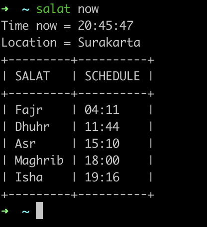
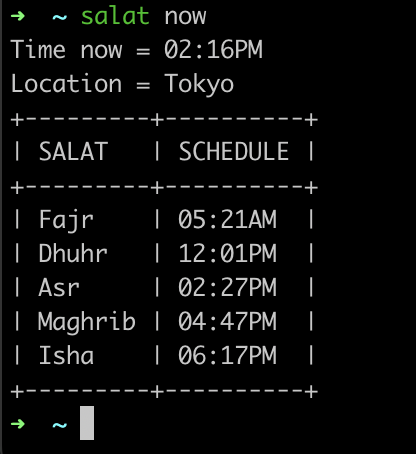
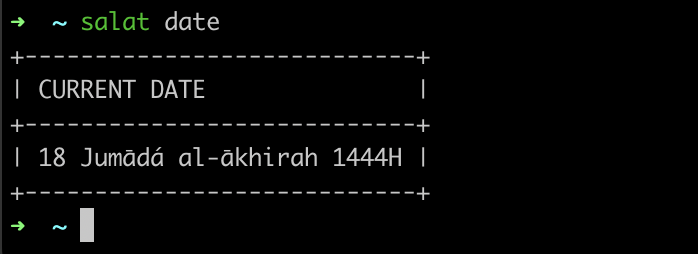
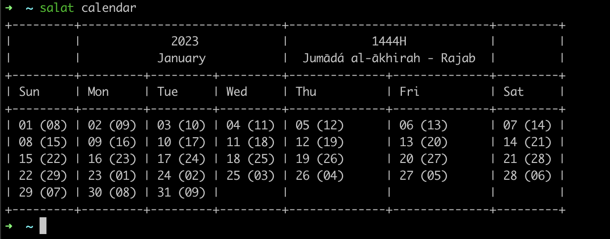

<div align="center">

# Salat

**A CLI to know the prayer times in Islam** :mosque:

[](https://github.com/alfajrimutawadhi/salat/releases)
[](https://go.dev)

[](LICENSE)

</div>

<div align="center">

<table>
  <tr>
    <td align="center" width="50%"><br /><b>Prayer schedule</b></td>
    <td align="center" width="50%"><br /><b>Set location</b></td>
  </tr>
  <tr>
    <td align="center"><br /><b>Hijri date</b></td>
    <td align="center"><br /><b>Hijri calendar</b></td>
  </tr>
</table>

</div>

---

## Installation

### Linux / macOS

Install or update with the install script:

```sh
curl -sfL https://raw.githubusercontent.com/alfajrimutawadhi/salat/master/install.sh | bash -
```

### Windows

Install or update with the PowerShell installer:

```powershell
powershell -c "irm https://raw.githubusercontent.com/alfajrimutawadhi/salat/master/install.ps1 | iex"
```

This installs `salat.exe` and the default `config.json` into
`%USERPROFILE%\.salat` and adds that folder to your user PATH. Open a
**new terminal** afterwards so `salat` is picked up.

Or install manually:

1. Download `salat-<tag>-windows-amd64.zip` from the
   [releases page](https://github.com/alfajrimutawadhi/salat/releases).
2. Extract `salat.exe` into a folder that is on your PATH (for example
   `%USERPROFILE%\.salat`).
3. Run `salat` from a new terminal.

> ARM64 builds are for Windows-on-Arm devices (e.g. Surface Pro X or
> Snapdragon laptops) — use `salat-<tag>-windows-arm64.zip` instead.

## Uninstall

### Linux / macOS

Remove Salat from your system with the uninstall script:

```sh
curl -sfL https://raw.githubusercontent.com/alfajrimutawadhi/salat/master/uninstall.sh | bash -
```

### Windows

Remove Salat with the PowerShell uninstaller:

```powershell
powershell -c "irm https://raw.githubusercontent.com/alfajrimutawadhi/salat/master/uninstall.ps1 | iex"
```

## OS Support

| OS      | Architecture      |
|---------|-------------------|
| Linux   | amd64, arm64      |
| MacOS   | amd64, arm64      |
| Windows | amd64, arm64      |

## Features

### 1. Prayer Schedule
Display the current time and prayer schedules based on your location.

```sh
salat now
```

You can change your location with the `set-location` command:

```sh
salat set-location
```

### 2. Hijri Date
Display the current date in Hijri calendar* based on your device's time.

```sh
salat date
```

### 3. Hijri Calendar
Display the Hijri calendar* for the current month based on your device's time.

```sh
salat calendar
```

\* Default uses calculation method **3** (Muslim World League).

## Commands

| Command         | Description                                                       |
|-----------------|-------------------------------------------------------------------|
| `now`           | Display today's prayer schedule                                   |
| `date`          | Display the current Hijri date                                    |
| `calendar`      | Display Hijri calendar of the current month                       |
| `show-location` | Show your current location (default: Jakarta, Indonesia)          |
| `set-location`  | Change your location                                              |
| `time-mode`     | Change time mode between 12-hour and 24-hour (default: 24-hour)   |
| `version`       | Check application version                                         |

## Configuration

Configuration is stored in `~/.salat/config.json` (on Windows:
`%USERPROFILE%\.salat\config.json`):

```json
{
  "location": {
    "country": "Indonesia",
    "city": "Jakarta"
  },
  "time_mode": 2
}
```

> `time_mode` — `1` for 12-hour, `2` for 24-hour format.

## How It Works

Salat fetches data from the [Aladhan API](https://aladhan.com/prayer-times-api).

## Credits

- [Aladhan API](https://aladhan.com) — prayer schedule & Hijri data
- [go-pretty](https://github.com/jedib0t/go-pretty) — terminal table rendering

## License

Released under the [MIT License](LICENSE).
